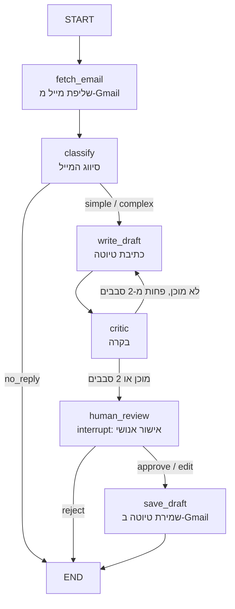
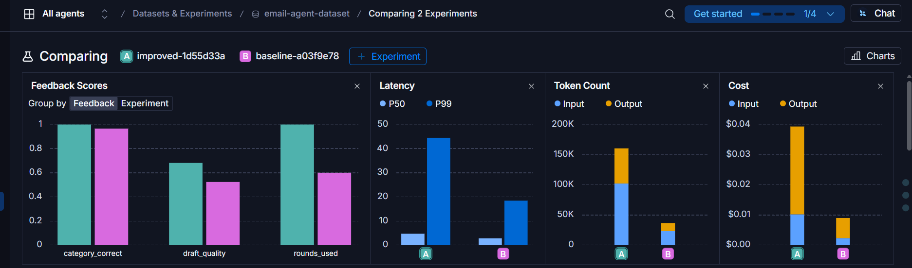
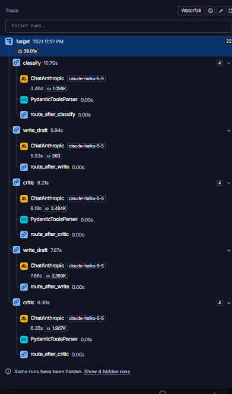
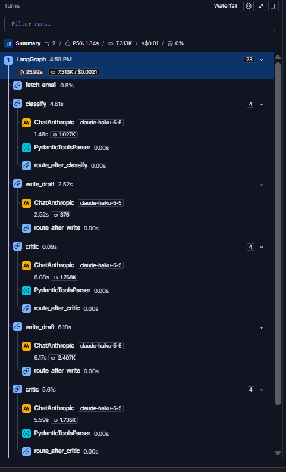
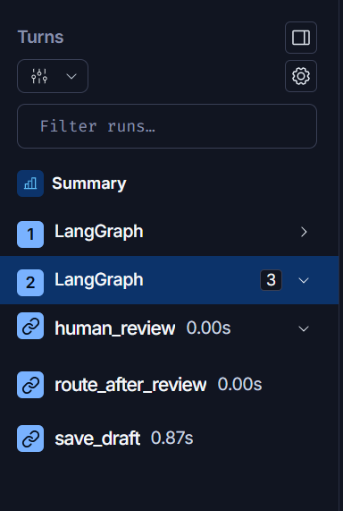

# סוכן טיוטות מייל (LangGraph)

סוכן שקורא מייל אמיתי מ-Gmail, מחליט אם צריך להשיב עליו, מנסח טיוטת תשובה, בודק את איכותה בלולאה, ועוצר לאישור אנושי לפני שמירה.
**הסוכן שומר טיוטה בלבד ולעולם לא שולח מייל.**

תרגיל הגשה 2: LangGraph, ענף מותנה ולולאה, `interrupt` (human-in-the-loop), דאטהסט והערכה אוטומטית ב-LangSmith עם ניסוי לפני ואחרי שיפור.

---

## איך הסוכן עובד



| דרישה | איפה בגרף |
|---|---|
| **ענף מותנה** | אחרי `classify`: מייל שלא דורש תשובה מסתיים. כתיבה, בקרה ואישור הן גם החלטות מותנות |
| **לולאה** | `critic` מחזיר ל-`write_draft` עם הערות, עד `MAX_ROUNDS = 2` |
| **Human-in-the-loop** | `interrupt()` ב-`human_review`: המשתמש מאשר, עורך או דוחה. `MemorySaver` שומר את המצב בזמן העצירה |

**ה-State** (המידע שעובר בין הצמתים): המייל, הקטגוריה, הטיוטה, הערות המבקר, מונה סבבים, החלטת האדם ומזהה הטיוטה שנשמרה.

**שלוש קטגוריות:** `no_reply` (ניוזלטר, הודעה אוטומטית, קבלה), `simple` (אישור, תיאום, תודה), `complex` (כמה שאלות, תלונה, נושא רגיש).

---

## מבנה הפרויקט

| קובץ | תפקיד |
|---|---|
| `graph.py` | ה-State, הצמתים והגרף |
| `run.py` | הרצה על מייל אמיתי, כולל שלב האישור האנושי |
| `gmail_utils.py` | חיבור ל-Gmail (קריאה ויצירת טיוטות בלבד) |
| `dataset_data.py` | 30 מיילים מדומים עם הסיווג הנכון |
| `create_dataset.py` | העלאת הדאטהסט ל-LangSmith |
| `eval.py` | הרצת הערכה: `baseline` או `improved` |

## הרצה

```bash
pip install -r requirements.txt
```

קובץ `.env` עם: `ANTHROPIC_API_KEY`, `LANGSMITH_API_KEY`, `LANGSMITH_TRACING=true`.
המודל הוא `claude-haiku-5-5` (ניתן להחלפה בשורת `MODEL` ב-`graph.py`).

```bash
python create_dataset.py        # פעם אחת
python eval.py baseline         # גרסה בסיסית
python eval.py improved         # גרסה משופרת
python run.py                   # מייל אמיתי (דורש credentials.json מ-Google Cloud)
```

`credentials.json`, `token.json` ו-`.env` נמצאים ב-`.gitignore` ואין להעלות אותם.

---

## דאטהסט והערכה ב-LangSmith

**דאטהסט:** 30 מיילים מדומים בעברית ובאנגלית: 8 `no_reply`, 11 `simple`, 11 `complex`. כללתי כמה מיילים עם שתי בעיות יחד, ומקרה גבולי אחד (מייל תודה, ראו "מגבלות").

**שלושה evaluators:**

| evaluator | סוג | מה הוא בודק |
|---|---|---|
| `category_correct` | קוד | האם הסיווג זהה לסיווג הנכון (1/0) |
| `draft_quality` | LLM-as-judge | האם הטיוטה עונה על כל הנקודות, בטון מתאים, ובלי הבטחות שלא הוזכרו. לא מופעל כשאין טיוטה |
| `rounds_used` | קוד | כמה סבבי כתיבה נדרשו (מדד יעילות) |

**ההבדל בין המבקר לשופט:** המבקר הוא חלק מהסוכן ומשנה את התוצאה (מחזיר לתיקון). השופט הוא חלק מההערכה, רץ אחרי שהסוכן סיים, ורק נותן ציון.

### ניסוי לפני ואחרי

| | baseline | improved |
|---|---|---|
| **סיווג** | פרומפט פשוט | הגדרות ושש דוגמאות (שונות מאלה שבדאטהסט) |
| **מבקר ולולאה** | כבוי | דולק, עד 2 סבבים |

אותם 30 מיילים, אותו מודל, אותם evaluators. המתגים (`few_shot`, `use_critic`) נשמרו כ-metadata של כל ניסוי.

| מדד | baseline | improved |
|---|---|---|
| `category_correct` | 0.97 | **1.00** |
| `draft_quality` | 0.52 | **0.68** |
| `rounds_used` (ממוצע) | 0.70 | 1.17 |
| זמן חציוני (P50) | 2.81s | 4.73s |
| זמן בתרחיש הגרוע (P99) | 18.45s | 44.48s |
| שגיאות | 0% | 0% |



**קריאה זהירה של התוצאות:**

- איכות הטיוטה עלתה מ-0.52 ל-0.68. הציון מחושב על 22 המיילים שדורשים תשובה, בריצה אחת לכל גרסה, ולכן זו מגמה ולא הוכחה סטטיסטית.
- המחיר: סבבי הכתיבה עלו, הזמן בתרחיש הגרוע גדל פי כ-2.4, והצריכה והעלות גדלו (לפי תרשימי LangSmith: בערך פי 2 עד 3 בעלות, כמה סנטים להרצה של 30 מיילים).
- חלק משיפור הסיווג נובע כנראה מהבהרת הגדרה ולא מהבנה "חכמה" יותר (ראו מגבלות).

---

## תובנה מה-traces

> **הבקרה האוטומטית לא מחליפה את האדם, ולכן העצירה לאישור אנושי חיונית דווקא בנקודה הזו.**



מה גיליתי בבדיקת ה-traces של הגרסה המשופרת:

1. **המבקר דורש דברים שהסוכן לא יכול לדעת.** במייל של דיווח באג (`Login fails on mobile`), המבקר החזיר את הטיוטה הראשונה כי נשארו בה תבניות ריקות (`[Insert target date...]`, `[Your name]`) והיא לא ענתה על "מתי יהיה תיקון" ו"האם יש פתרון עוקף". מידע כזה לא מופיע במייל, ולכן שכתוב לא יכול להשלים אותו. הלולאה יקרה כאן: ב-trace רואים שבסבב השני נשלחו למודל כ-3,359 טוקנים, לעומת 893 בסבב הראשון, כי נוספו הטיוטה הקודמת וההערות.
2. **המבקר פספס סתירה שהשופט תפס.** במייל "אפשר להזיז לחמישי באותה שעה?", הטיוטה אישרה "באותה שעה" ובמקביל ביקשה שעה מדויקת. המבקר אישר אותה בסבב הראשון, והשופט נתן 0. **השערה** (ממקרה אחד): כשאותו מודל כותב ובודק, הוא נוטה לא לראות את הטעויות של עצמו.

**המשמעות:** בלולאה האוטומטית יש תקרה. המידע החסר נמצא אצל המשתמש (יומן, תאריכי פיתוח), ולכן ה-`interrupt` הוא המקום שבו האדם משלים אותו, ולא רק "חותמת".

---

## ריצה על מייל אמיתי

הרצתי את הסוכן על מייל אמיתי בתיבת Gmail (פנייה של לקוח על הזמנה שלא הגיעה). הצילומים מציגים רק את שלבי הריצה והזמנים, בלי תוכן המייל.

**חלק 1: מהמייל ועד העצירה לאישור.** `fetch_email` שולף את המייל מ-Gmail, `classify` מסווג אותו `simple`, ואז `write_draft` ו-`critic` רצים פעמיים: המבקר החזיר את הטיוטה לתיקון, והסוכן כתב שוב. הריצה כולה לקחה כ-26 שניות, כ-7,300 טוקנים ועלות של כ-0.002 דולר.



**חלק 2: אחרי האישור האנושי.** ה-`interrupt` עצר את הגרף והציג את המייל, הטיוטה והערות המבקר. אחרי שהחלטתי, הגרף המשיך מאותה נקודה: `human_review`, `route_after_review` ו-`save_draft`, והטיוטה נשמרה בתיקיית Drafts ב-Gmail. לא נשלח שום מייל.



**למה יש שני חלקים?** ה-`interrupt` מפצל את הריצה לשתי פניות (turns): הראשונה נגמרת בעצירה, והשנייה מתחילה כשהמשתמש עונה. ה-`MemorySaver` (checkpointer) שומר את מצב הגרף ביניהן, ובלעדיו אי אפשר היה להמשיך מאותה נקודה.

**מה עוד רואים:** גם כאן הטיוטה הכילה תבניות ריקות (כמו שם החברה וסטטוס ההזמנה), כי הסוכן לא יודע את הפרטים האלה. המבקר סימן אותן, אבל שכתוב לא יכול למלא מידע שחסר, ולכן האישור האנושי הוא השלב שבו אדם משלים או דוחה.

---

## מגבלות

- **הדאטהסט קטן ומדומה** (30 מיילים), והתוצאות מריצה אחת. ההבדלים בין הגרסאות הם מגמה, לא הוכחה.
- **השופט הוא מודל** ולכן עלול לטעות או להחמיר. בדקתי את הנימוק שלו בציון אחד (סתירה בשעה) והוא צדק.
- **מייל תודה** סווג בדאטהסט כ-`simple`, אבל הסוכן בגרסה הבסיסית סיווג אותו `no_reply`. זה מקרה גבולי, והדוגמאות בגרסה המשופרת דומות לו, ולכן שיפור הסיווג כנראה משקף חלקית את הבהרת ההגדרה.
- **פרטיות:** תוכן המיילים נשמר ב-traces ב-LangSmith. לכן הניסוי רץ על מיילים מדומים, ובדיקת Gmail על מייל ללא מידע רגיש.

## צעדים הבאים

- **מבקר ממודל אחר או חזק יותר**, כדי לבדוק את ההשערה שמודל עצמאי תופס יותר טעויות. השופט צריך להישאר מודל שונה מהמבקר.
- **הוראה בפרומפט הכתיבה:** "אל תשאיר תבניות ריקות ואל תמציא עובדות", כדי לחסוך סבבים שאי אפשר לפתור.
- **קריטריון במבקר** שבודק סתירות והאם מבקשים פרט שכבר נמסר.
- **דאטהסט גדול יותר עם מיילים אמיתיים (מטושטשים), וכמה הרצות לכל גרסה**, כדי לראות אם ההבדל יציב ובאילו סוגי מיילים הבקרה עוזרת.
